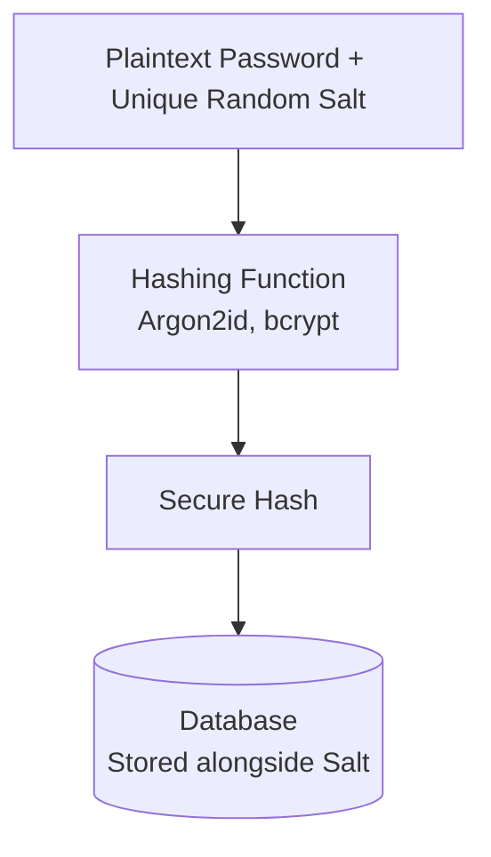
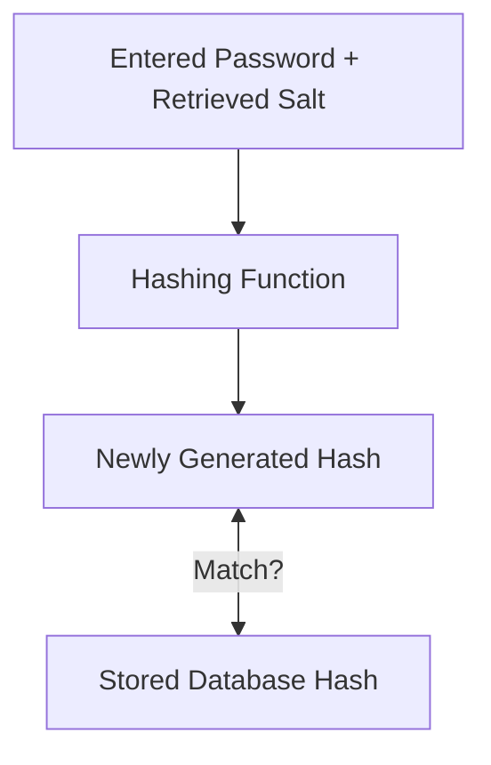

# Password Hashing & Salting

A comprehensive overview of how password hashing and salting work together to secure user authentication systems against credential leaks and brute-force attacks.

## 🛡️ Core Concepts

### 1. Password Hashing
Password hashing is a **one-way cryptographic process** that transforms a plaintext password into a fixed-length string of characters (a hash). 

* **Irreversible:** A secure hash function cannot be reverse-engineered to reveal the original password.
* **Deterministic:** The same password input will always produce the exact same hash output.
* **Verification:** During login, the application hashes the incoming password and compares it to the stored hash.

### 2. Password Salting
A salt is a **unique, randomly generated string** added to a user's password *before* it is processed by the hashing function.

* **Unique Outputs:** If two users share the same password (e.g., `Password123`), unique salts ensure their stored hashes are completely different.
* **Precomputation Defense:** Salting completely neutralizes precomputed **Rainbow Table** attacks and bulk dictionary matching.

---

## 🔄 Authentication Workflow

### User Registration

1. The user creates a new account and sets a password.
2. The system generates a cryptographically secure random **salt**.
3. The system appends/prepends the salt to the plaintext password.
4. The combined string is processed through a modern hashing algorithm.
5. The **salt** and the resulting **hash** are stored securely in the database.

### User Login

1. The user enters their password on the login form.
2. The system looks up the user's record and retrieves their unique **salt**.
3. The system combines the entered password with the retrieved salt.
4. The combined string is run through the same hashing function.
5. The system compares the newly generated hash with the hash stored in the database. If they match, access is granted.

---

## 🚫 Attack Vectors Defeated

* **Database Leaks:** If attackers steal the database, they only see randomized hashes, not raw user passwords.
* **Rainbow Tables:** Precomputed lists of password-to-hash mappings fail because the attacker cannot precompute tables for every possible random salt.
* **Bulk Cracking:** Attackers must guess passwords for each account individually rather than cracking identical hashes simultaneously.

---

## 🚀 Modern Recommendations

When implementing password storage, avoid outdated, fast algorithms like **MD5, SHA-1, or SHA-256**. Instead, use slow, resource-intensive functions designed specifically for password hashing:

* **Argon2id:** The current industry standard (winner of the Password Hashing Competition). It offers memory-hardness to resist GPU/ASIC cracking.
* **bcrypt:** A time-tested, adaptive hashing function that relies on an adjustable work factor to scale with hardware advancements.
* **scrypt:** A memory-hard function designed to make hardware-accelerated parallel attacks prohibitively expensive.
